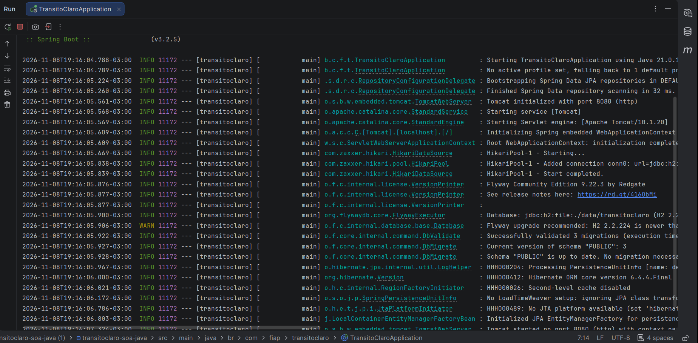
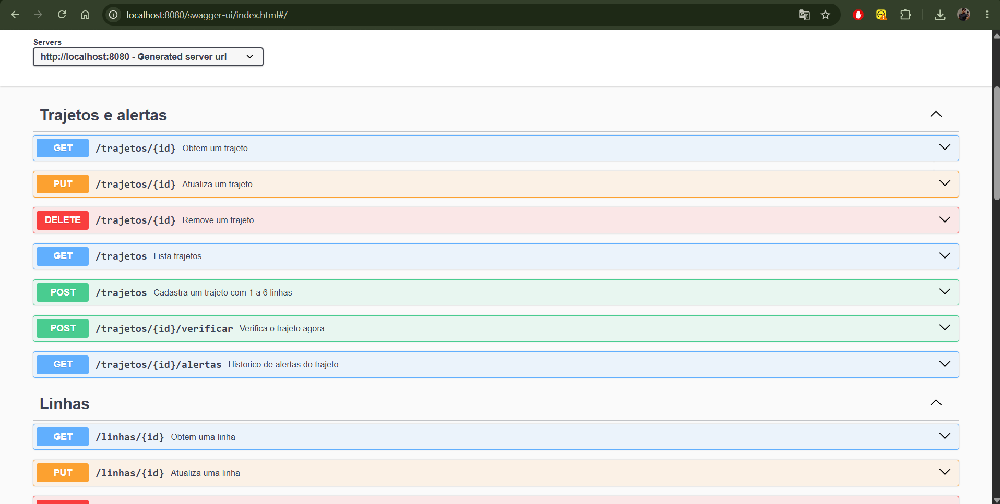
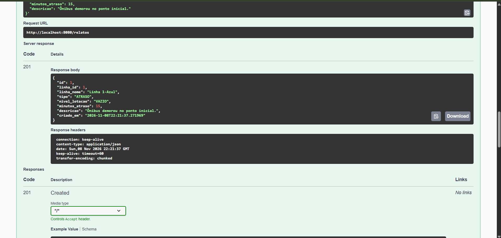
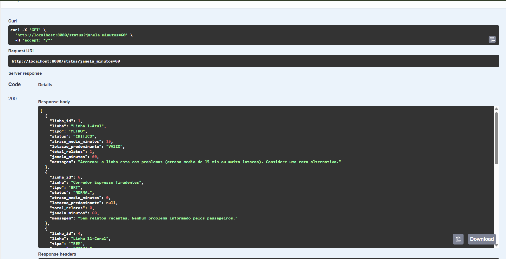
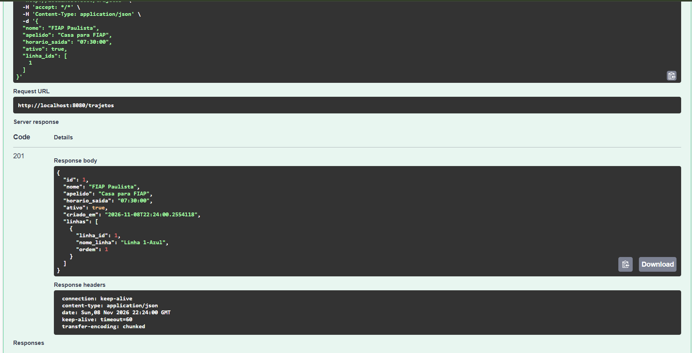

# TransitoClaro — CitizenTech para quem depende de metrô, trem e BRT (Java)

> Global Solution 2026.2 · FIAP · Engenharia de Software · **Arquitetura Orientada a Serviços (SOA) e Web Services**
> Stack: Java 17 · Spring Boot 3.2 · Spring Data JPA · Flyway · springdoc (Swagger) · JUnit 5

Projeto **independente**: um único backend com seu próprio banco, que expõe uma API REST.

## Integrantes

| Nome | RM |
|---|---|
| Pietro Vitor Pezzente | RM557283 |
| Eric Darakjian | RM557082 |
| Kauã Soares Guimarães | RM559044 |
| Enzo Mikael Sanches | RM558887 |

## Ficha da CitizenTech

| Campo | Resposta |
|-------|----------|
| **Nome da CitizenTech** | TransitoClaro |
| **Cidadão beneficiado** | Passageiro que depende de metrô, trem ou BRT e precisa decidir a rota sem saber o que acontece nas linhas |
| **Problema, em uma frase** | Quem depende do transporte público perde horas porque não sabe, antes de sair, quais linhas estão atrasadas ou lotadas. |
| **Como funciona** | Os próprios passageiros enviam relatos anônimos (atraso, lotação, falha). A API reúne os relatos da última hora e devolve, para cada linha, um status simples (**NORMAL / MODERADO / CRITICO**). O passageiro também cadastra seus trajetos e, ao verificar, recebe um alerta: *pode sair / saia antes / evite*. |
| **O que cada parte faz** | **SOA (este repo):** API de linhas, relatos, status e trajetos/alertas · demais disciplinas constroem as outras partes da mesma solução (app, IoT, ML etc.) |
| **Indicador de impacto** | Nº de relatos por período e linhas com mais atrasos (`GET /relatos/estatisticas`); nº de alertas Crítico/Moderado emitidos por trajeto |
| **ODS conectados** | **ODS 11** (cidades e comunidades sustentáveis – transporte público), **ODS 9** (inovação e infraestrutura), **ODS 10** (redução das desigualdades – informação para quem mais depende do transporte) |

### Como a solução contribui para os ODS
- **ODS 11 (meta 11.2):** informação confiável torna o transporte público mais utilizável e seguro.
- **ODS 9:** usa dados colaborativos e tecnologia simples para aproveitar melhor a infraestrutura existente.
- **ODS 10:** quem não tem alternativa ao transporte público é quem mais perde tempo sem informação.

## Arquitetura

```
Controllers (REST)  →  Services (casos de uso)  →  Repositories (Spring Data JPA)  →  banco (H2 / PostgreSQL)
                              ↓
                  Domain (entidades, regras, ClassificadorStatus)
```

```
src/main/java/br/com/fiap/transitoclaro/
  domain/    Linha, Relato, Trajeto, TrajetoLinha, Alerta (entidades JPA), enums, Regras,
             ClassificadorStatus (+ ClassificadorPorRelatos), repositórios, exceções de domínio
  service/   LinhaService, RelatoService, StatusService, TrajetoService, AlertaService
  web/       controllers REST, Dtos (validação Bean Validation), GlobalExceptionHandler (ProblemDetail)
  config/    AppConfig (Clock e metadados do OpenAPI)
src/main/resources/db/migration/   V1 linhas+relatos · V2 trajetos+alertas · V3 dados iniciais (Flyway)
src/test/                          JUnit 5 + MockMvc
```

## Como executar

Pré-requisitos: **JDK 17+** e **Maven 3.9+** (ou abra a pasta em uma IDE como IntelliJ/Eclipse/VS Code, que já traz o Maven).

```bash
mvn spring-boot:run          # as migrações Flyway rodam sozinhas na subida
```

- **Swagger (documentação automática):** http://localhost:8080/docs · OpenAPI em `/v3/api-docs`
- **Banco:** H2 em arquivo (`./data/transitoclaro`) por padrão, já com 6 linhas de exemplo de São Paulo.
  Para PostgreSQL: `DATABASE_URL=jdbc:postgresql://localhost:5432/transitoclaro DATABASE_USER=... DATABASE_PASSWORD=...`

### Testes
```bash
mvn test
```
Os testes usam H2 em memória (schema criado pelas mesmas migrações Flyway).

## Endpoints

| Método | Rota | Descrição |
|--------|------|-----------|
| GET | `/linhas?tipo=METRO\|TREM\|BRT` | Lista linhas |
| GET / PUT / DELETE | `/linhas/{id}` | Detalhe / atualiza / remove (se não estiver em uso em trajetos) |
| POST | `/linhas` | Cadastra linha |
| POST | `/relatos` | Envia relato anônimo (`ATRASO`, `LOTACAO`, `FALHA_OPERACIONAL`) |
| GET | `/relatos?linha_id=&tipo=&pagina=&tamanho=` | Lista relatos (paginado, mais recentes primeiro) |
| GET / DELETE | `/relatos/{id}` | Detalhe / remove |
| GET | `/relatos/estatisticas?horas=24` | Indicador de impacto |
| GET | `/status?janela_minutos=60` | Status de todas as linhas (piores primeiro) |
| GET | `/status/{linhaId}?janela_minutos=60` | Status de uma linha |
| POST | `/trajetos` | Cadastra trajeto com 1 a 6 linhas (`linha_ids`) |
| GET | `/trajetos?apenas_ativos=` | Lista trajetos |
| GET / PUT / DELETE | `/trajetos/{id}` | Detalhe / atualiza / remove |
| POST | `/trajetos/{id}/verificar` | Calcula o pior status entre as linhas do trajeto e salva o alerta |
| GET | `/trajetos/{id}/alertas?limite=` | Histórico de alertas |
| GET | `/saude` | Health check |

Erros: `400` regra de negócio · `404` não encontrado · `422` validação dos campos.

### Regras de classificação (`ClassificadorPorRelatos`)
- **CRITICO:** atraso médio ≥ 15 min, **ou** ≥ 50% dos relatos de lotação são `LOTADO`, **ou** ≥ 3 falhas.
- **MODERADO:** atraso médio ≥ 5 min, **ou** ≥ 50% `CHEIO` ou pior, **ou** ≥ 1 falha.
- **NORMAL:** demais casos (inclui linha sem relatos na janela).

### Exemplo de uso
```http
POST /relatos
{ "linha_id": 4, "tipo": "ATRASO", "minutos_atraso": 18, "descricao": "Trem parado há 10 minutos" }

POST /trajetos
{ "nome": "Casa-Faculdade", "apelido": "passageira-zl", "horario_saida": "07:30:00", "linha_ids": [4, 3] }

POST /trajetos/1/verificar
{ "alerta": { "status": "CRITICO", "linha_mais_afetada": "Linha 11-Coral",
              "mensagem": "Evite sair agora: Linha 11-Coral esta com problemas graves. Considere uma rota alternativa." },
  "linhas": [ ... status de cada linha ... ] }
```

## Critérios da disciplina → onde estão

| Critério | Onde |
|----------|------|
| **Estruturação do domínio (3,0)** | `domain/` (entidades `Linha`, `Relato`, `Trajeto`, `TrajetoLinha`, `Alerta`; regras em `Relato.criar`, `Trajeto.definirLinhas`, `ClassificadorPorRelatos`, `Regras`), camadas web → service → domain |
| **Conexão com banco de dados (3,0)** | Spring Data JPA/Hibernate, relacionamentos (`@ManyToOne`, `@OneToMany` com cascade e `orphanRemoval`), consultas derivadas e paginação, datasource por variáveis de ambiente |
| **Migrações (1,5)** | Flyway: `V1__criar_linhas_e_relatos.sql`, `V2__criar_trajetos_e_alertas.sql`, `V3__dados_iniciais_linhas.sql`; `ddl-auto: validate` confere entidades × schema |
| **Documentação automática (1,5)** | springdoc-openapi: Swagger UI em `/docs` |
| **Testes automatizados (1,0)** | `src/test`: regras de domínio e classificador (JUnit puro) + testes de API com MockMvc para linhas, relatos, status e trajetos/alertas |
| **Chamadas REST** | API REST completa (GET/POST/PUT/DELETE) com códigos HTTP corretos e erros padronizados (RFC 7807) |

## Dados e privacidade
Nenhum dado pessoal: relatos são anônimos e o passageiro usa só um `apelido` livre. As linhas iniciais são dados de exemplo; confira com as fontes oficiais (Metrô SP, CPTM/ViaMobilidade, SPTrans) antes de qualquer uso real.

## Evidências de funcionamento

1. Aplicação subindo com as migrações Flyway aplicadas — _print do log_
2. Swagger (`/docs`) com os endpoints — 
3. `POST /relatos` (201) e `GET /status` com linha CRITICO —  
4. `POST /trajetos/{id}/verificar` com o alerta — 
